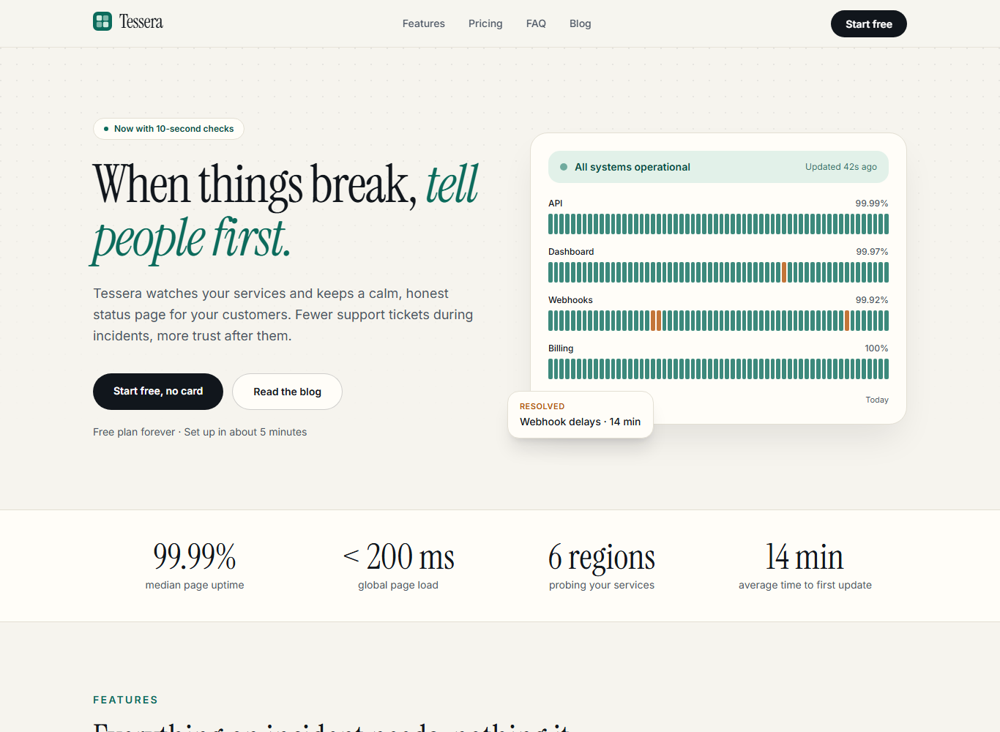
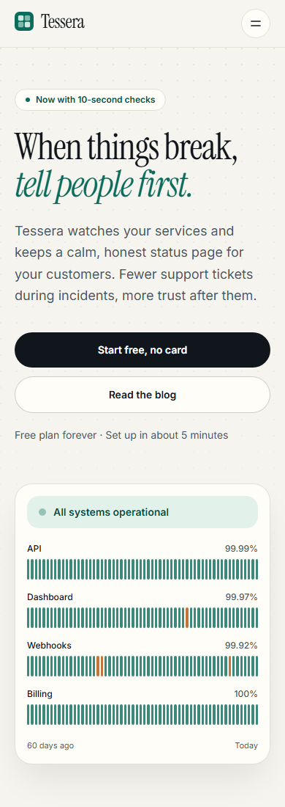
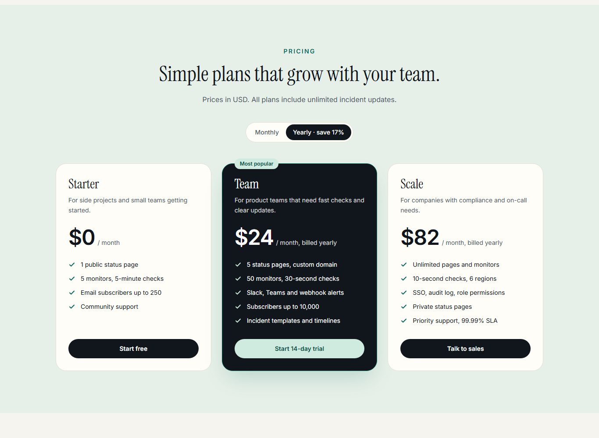
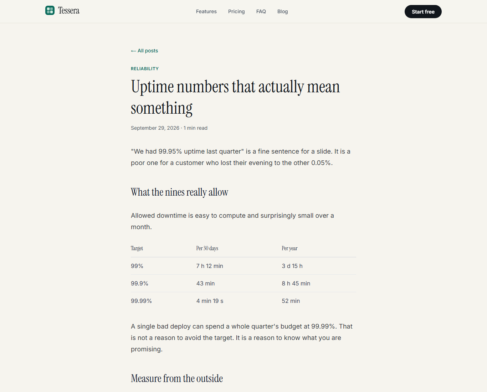

# Tessera landing page

A landing page for **Tessera**, a fictional SaaS that offers status pages and incident communication. It has a hero, features, a pricing table with a monthly/yearly toggle, an FAQ and an MDX blog with three posts.

**Live:** https://alissonlittig.github.io/tessera-landing/

All names, prices and metrics are invented. No real data, no tracking, no secrets.

| Desktop | Mobile (390 px) |
| --- | --- |
|  |  |
|  |  |

## Stack

- Next.js (App Router) with `output: "export"`, so the site is fully static
- TypeScript (strict)
- Tailwind CSS v4 and `@tailwindcss/typography`
- MDX posts rendered with `next-mdx-remote` and `remark-gfm`, front matter via `gray-matter`
- `next/font` (Inter and Instrument Serif)
- GitHub Actions: type check, build and deploy to GitHub Pages

## Details

- SEO: per-page titles and descriptions, canonical URLs, Open Graph and Twitter cards, JSON-LD for posts, `sitemap.xml`, `robots.txt`
- Accessibility: skip link, semantic landmarks, visible focus, `aria-pressed` on the billing toggle, native `<details>` for the FAQ and the mobile menu, reduced-motion support
- No horizontal scroll at 390 px
- Pricing toggle is the only client component; everything else is server-rendered at build time

## Run locally

```bash
npm install
npm run dev        # http://localhost:3000
npm run lint       # tsc --noEmit
npm run build      # static site in ./out
```

For a Pages-style build, set the sub-path: `NEXT_PUBLIC_BASE_PATH=/tessera-landing npm run build`.

## Adding a post

Create `content/posts/<slug>.mdx` with `title`, `description`, `date` (YYYY-MM-DD) and `tag` in the front matter. The `<Callout>` component is available in the body.
